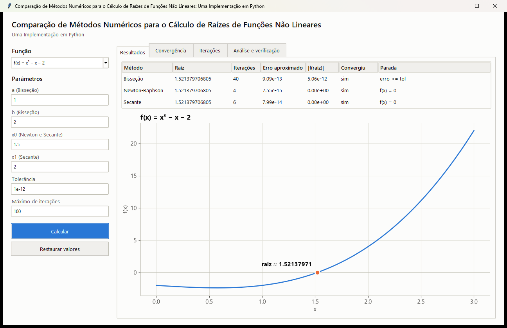
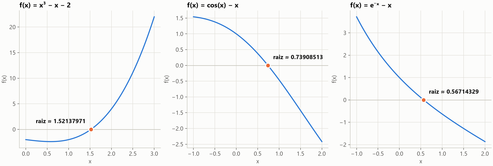
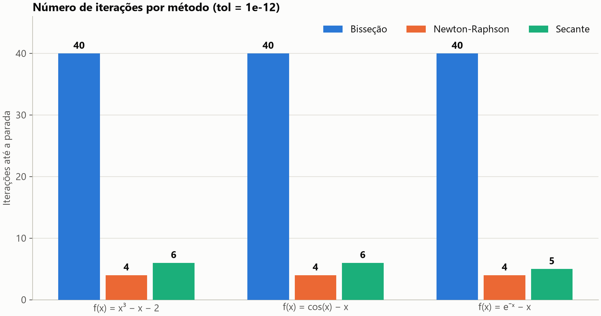

# Comparação de Métodos Numéricos para o Cálculo de Raízes de Funções Não Lineares

**Uma Implementação em Python**

[](https://github.com/geovanni10a/comparacao-de-metodos-numericos-para-o-calculo-de-raizes-de-funcoes-nao-lineares/actions/workflows/testes.yml)

[](LICENSE)

Demonstração computacional que implementa e compara os métodos da **Bisseção**, de
**Newton-Raphson** e da **Secante**, com fundamentação matemática, metodologia experimental e
resultados verificáveis. O projeto foi desenvolvido para apresentação em uma feira científica de
Matemática.



## Sumário

- [Sobre o projeto](#sobre-o-projeto)
- [Funcionalidades](#funcionalidades)
- [Resultados](#resultados)
- [Como começar](#como-começar)
- [Como usar](#como-usar)
- [Estrutura do projeto](#estrutura-do-projeto)
- [Metodologia e reprodutibilidade](#metodologia-e-reprodutibilidade)
- [Limitações](#limitações)
- [Suporte](#suporte)
- [Como contribuir](#como-contribuir)
- [Como citar](#como-citar)
- [Autoria](#autoria)
- [Licença](#licença)

## Sobre o projeto

Encontrar uma raiz é encontrar `r` tal que `f(r) = 0`. Como muitas equações não têm solução
prática por fórmula fechada, métodos iterativos constroem uma sequência de aproximações. Os métodos
diferem no que exigem da função, na velocidade e nas garantias de convergência.

| Método | Ideia | Fórmula | Ordem teórica | Exige |
|---|---|---|---|---|
| Bisseção | Divide ao meio o intervalo com troca de sinal | `c = (a + b) / 2` | 1 | Intervalo com troca de sinal |
| Newton-Raphson | Segue a reta tangente | `x_(k+1) = x_k − f(x_k) / f'(x_k)` | 2 | Derivada e um valor inicial |
| Secante | Segue a reta pelos dois últimos pontos | `x_(k+1) = x_k − f(x_k)(x_k − x_(k−1)) / (f(x_k) − f(x_(k−1)))` | cerca de 1,618 | Dois valores iniciais |

As funções estudadas são `x³ − x − 2`, `cos(x) − x` e `e^(−x) − x`, com tolerância de `1e-12`.

A fundamentação completa, com demonstrações, variáveis, interpretação e referências, está em
[EXPLICACAO.md](docs/EXPLICACAO.md).

## Funcionalidades

- Implementação independente de cada método, com critério de parada comum.
- Proteção contra divisão por zero, saída do domínio, overflow, polos e laços sem fim.
- Validação de intervalos e valores iniciais, com o motivo de cada parada.
- Análise de iterações, erro real, ordem empírica de convergência e estabilidade.
- 22 verificações matemáticas automáticas dos resultados.
- Exportação dos dados brutos em CSV, com todos os dígitos.
- Gráficos em Matplotlib e interface gráfica para Windows.
- Cálculos feitos somente com a biblioteca padrão do Python.

## Resultados

Número de iterações até a parada, com `tol = 1e-12`:

| Função | Raiz | Bisseção | Newton-Raphson | Secante |
|---|---|---|---|---|
| `x³ − x − 2` | `1,521379706805` | 40 | 4 | 6 |
| `cos(x) − x` | `0,739085133215` | 40 | 4 | 6 |
| `e^(−x) − x` | `0,567143290410` | 40 | 4 | 5 |

Ordem empírica de convergência:

| Função | Bisseção (teoria: 1) | Newton-Raphson (teoria: 2) | Secante (teoria: 1,618) |
|---|---|---|---|
| `x³ − x − 2` | 0,99 | 2,01 | 1,44 |
| `cos(x) − x` | 0,98 | 2,02 | 1,64 |
| `e^(−x) − x` | 0,99 | 2,00 | 1,61 |

Percentual de 200 condições iniciais, a até 10 unidades da raiz, que chegaram à raiz:

| Função | Bisseção | Newton-Raphson | Secante |
|---|---|---|---|
| `x³ − x − 2` | 100% | 100% | 100% |
| `cos(x) − x` | 100% | 85,5% | 100% |
| `e^(−x) − x` | 100% | 100% | 100% |

Os intervalos da Bisseção contêm a raiz por construção, então os 100% dela eram esperados.

**Nenhum método é universalmente melhor.** O desempenho depende da função e das condições iniciais.
Em `x³ − 2x + 2` com `x0 = 0`, por exemplo, Newton-Raphson entra em ciclo, e em `(x − 1)²` a Bisseção
não se aplica, pois não há troca de sinal.





## Como começar

### Requisitos

- Python 3.11 ou superior, por exigência da versão fixada do Matplotlib.
- Windows para a interface em `.exe`. O CI executa os testes em Windows.

### Instalação

```bash
git clone https://github.com/geovanni10a/comparacao-de-metodos-numericos-para-o-calculo-de-raizes-de-funcoes-nao-lineares.git
```

```bash
cd comparacao-de-metodos-numericos-para-o-calculo-de-raizes-de-funcoes-nao-lineares
```

```bash
python -m pip install -e .
```

## Como usar

Executar experimentos, análise, verificação, exportação e gráficos:

```bash
python -m raizes_numericas
```

Abrir a interface gráfica:

```bash
python -m raizes_numericas.interface
```

Rodar os testes:

```bash
python -m unittest discover -s tests
```

Gerar o executável `dist\RaizesNumericas.exe`, que abre sem Python instalado:

```bash
scripts\construir_exe.bat
```

O executável não tem assinatura digital, portanto o Windows pode exibir um aviso do SmartScreen.

Usar os métodos em outro programa:

```python
from raizes_numericas.metodos import FUNCOES, comparar

for r in comparar(**FUNCOES["cos(x) - x"]):
    print(r.metodo, r.raiz, r.iteracoes)
```

```text
Bisseção 0.7390851332156672 40
Newton-Raphson 0.7390851332151607 4
Secante 0.7390851332151607 6
```

## Estrutura do projeto

```text
.
├── src/raizes_numericas/     # Código do programa
│   ├── __main__.py           # Executa tudo com um comando
│   ├── metodos.py            # Métodos numéricos e funções estudadas
│   ├── analise.py            # Análise comparativa
│   ├── verificacao.py        # Verificação matemática e exportação de dados
│   ├── graficos.py           # Figuras em Matplotlib
│   └── interface.py          # Interface gráfica
├── tests/                    # Testes automáticos
├── docs/                     # Texto acadêmico e imagens da documentação
├── resultados/
│   ├── dados/                # Dados brutos em CSV
│   └── figuras/              # Gráficos gerados
├── scripts/                  # Geração do executável
├── .github/                  # CI e modelos de issue e pull request
└── pyproject.toml            # Metadados e dependências
```

## Metodologia e reprodutibilidade

O experimento controla a tolerância, o limite de iterações e o critério de parada. Não há números
aleatórios, então `python -m raizes_numericas` repete os resultados.

| Verificação automática | Quantidade | Resultado |
|---|---|---|
| Existe raiz a até `1e-11` de cada resultado | 9 | Aprovadas |
| Iterações da Bisseção iguais à previsão teórica | 3 | Aprovadas |
| Limite de erro da Bisseção em todas as iterações | 3 | Aprovadas |
| Erro de Newton-Raphson segue `C · e_k²` | 3 | Desvio máximo de 0,04% |
| Erro da Secante segue `C · e_k · e_(k−1)` | 3 | Desvio máximo de 0,10% |
| Duas execuções produzem resultados idênticos | 1 | Aprovada |

Os dados de cada método estão em [resultados/dados/resultados.csv](resultados/dados/resultados.csv), e os de cada
iteração em [resultados/dados/historico.csv](resultados/dados/historico.csv).

## Limitações

- O estudo usa três funções suaves, com uma única raiz real e raiz simples.
- Intervalos e valores iniciais foram escolhidos manualmente e influenciam as iterações.
- O experimento compara iterações, sem medir tempo de execução nem avaliações de função.
- A interface aceita somente as três funções do estudo.
- O executável não foi testado em computador sem Python instalado.

A lista completa está em [EXPLICACAO.md](docs/EXPLICACAO.md#10-limitações-do-experimento).

## Suporte

Dúvidas e problemas podem ser registrados nas
[issues](https://github.com/geovanni10a/comparacao-de-metodos-numericos-para-o-calculo-de-raizes-de-funcoes-nao-lineares/issues)
do repositório.

## Como contribuir

Contribuições são bem-vindas. Consulte o [guia de contribuição](CONTRIBUTING.md), o
[código de conduta](CODE_OF_CONDUCT.md) e a [política de segurança](SECURITY.md).

## Como citar

Os dados de citação estão em [CITATION.cff](CITATION.cff). No GitHub, use a opção **Cite this
repository**, na lateral da página.

## Autoria

Desenvolvido por [geovanni10a](https://github.com/geovanni10a).

## Licença

Distribuído sob a licença MIT. Consulte o arquivo [LICENSE](LICENSE).
